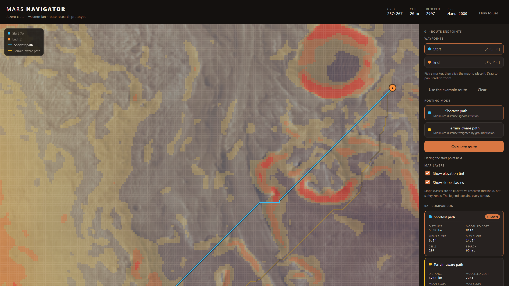
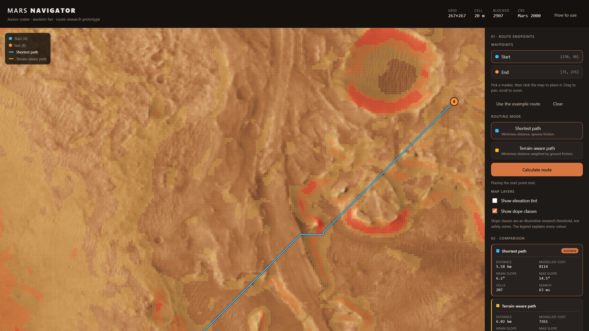

# MARS NAVIGATOR — presentation storyline (M4-06)

Five slides, 30 seconds of demo inside them. See `docs/DEMO_SCRIPT.md` for the
click-by-click run sheet.

---

## 1 · The problem

Choosing a traverse line on Mars is a trade-off that a flat map cannot show.
The shortest line across a crater fan can climb a 30° dune wall. The gentlest
line can be twice as long. A planner needs to see both at once, on the real
terrain, with the ground data they are allowed to trust.

## 2 · The NASA data

| Layer | Product | What it gives |
|---|---|---|
| Basemap | Mars 2020 Terrain Relative Navigation CTX orthomosaic (doi:10.5066/P9GV1ND3) | 6 m/px context image of Jezero's western fan |
| Navigation grid | M2-02 export from the D07 pipeline | 267 × 267 cells at 20 m, Mars 2000 sphere equirectangular |
| Elevation | D07 elevation raster | -2552.6 to -2101.3 m relative to the Mars 2000 datum |
| Slope classes | D07 hazard raster | 0 below 5°, 1 to 10°, 2 to 15°, 3 at 15° or more (also the blocked set) |

71,289 cells. 68,382 open for routing, 2,907 blocked. Every array shares one
affine, so a click on the image lands on exactly one grid cell.

## 3 · The solution

One A* engine, two objectives:

- **Shortest path** — minimises great-circle distance on the Mars sphere.
- **Terrain-aware path** — minimises distance weighted by the friction index
  `1 + (slope / 10)²`.

Both refuse blocked cells, both forbid diagonal corner cuts, and both report
distance, modelled cost, mean slope, maximum slope, cell count and search time
so the two can be compared side by side.

The engine is a direct port of the team's D08 prototype, and the app
reproduces its published example exactly: 207 cells at cost 8113.5 for the
shortest mode, 246 cells at 7261.5 for the terrain-aware mode.

## 4 · The demo

## 5 · The limits

State these plainly. A judge who hears them will trust the rest.

- **Friction is not physics.** `1 + (slope/10)²` is a dimensionless index. It is
  not energy, time, speed, energy per metre, or traction.
- **The 15° cutoff is uncalibrated.** It is an illustrative research threshold,
  not a validated safety limit. The slope classes are not hazard zones.
- **Image-to-DEM registration is unresolved.** Matching grid metadata proves
  the arrays share a coordinate frame; it does not prove the CTX pixels and the
  DEM cells describe the same piece of ground.
- **The DEM vertical datum is unresolved.**
- **A route here is not a traversability assessment.** Nothing in this app
  establishes that a rover can safely follow any path it draws.

## Provenance

- CTX orthomosaic: USGS Astrogeology Science Center, public domain (NASA/USGS).
- Navigation grid, elevation and hazard rasters: the team's D07 pipeline, from
  the MARS NAVIGATOR NASA data archive.
- Routing engine: the team's D08 prototype, ported to TypeScript.
- Full source provenance and SHA-256 checksums: `Data/README.md`,
  `Data/navigation/`, `Data/overlay/`.
